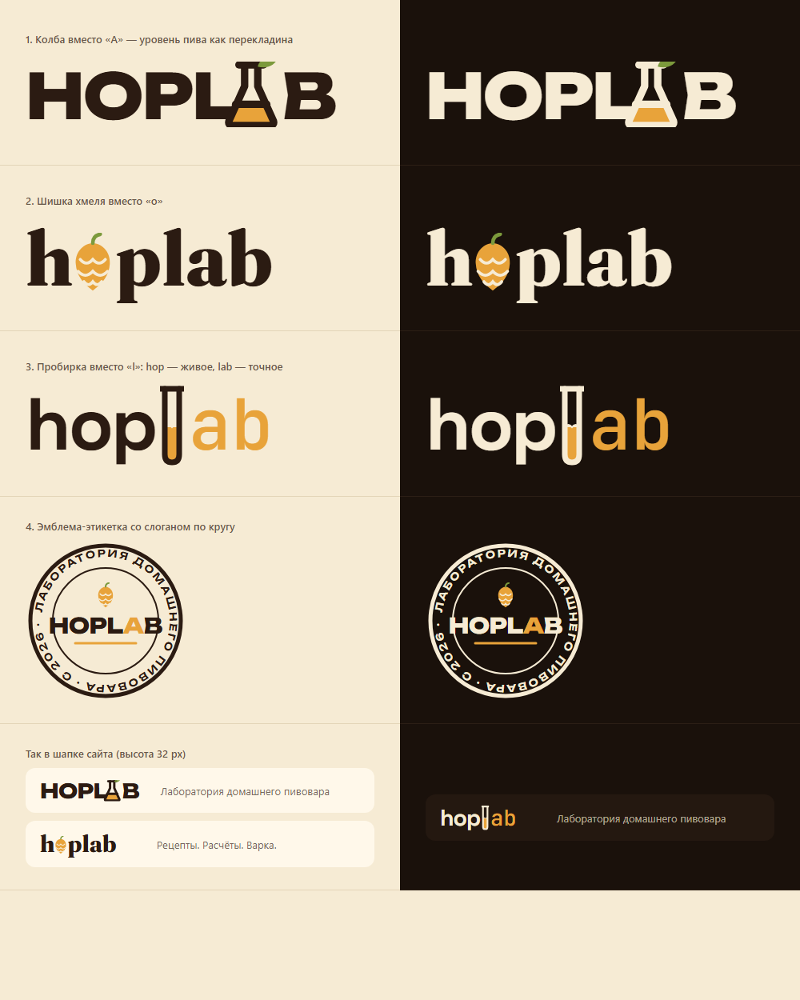
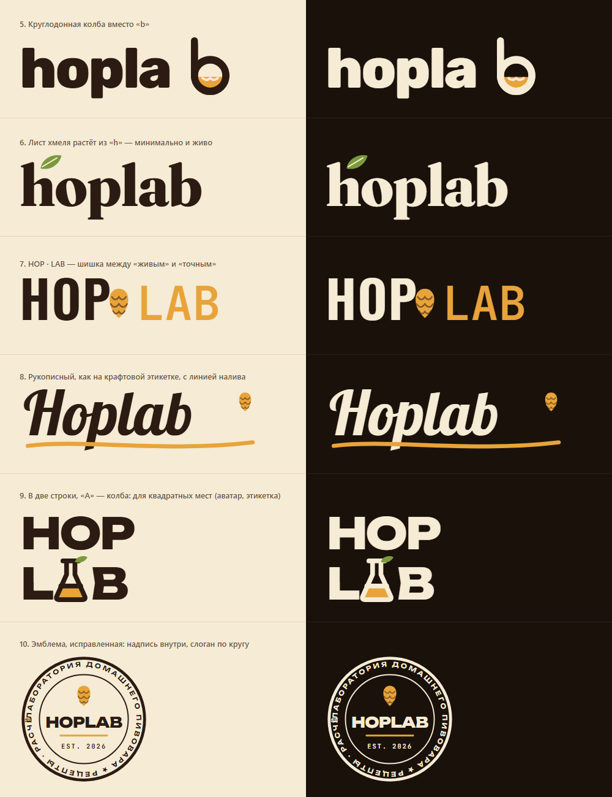
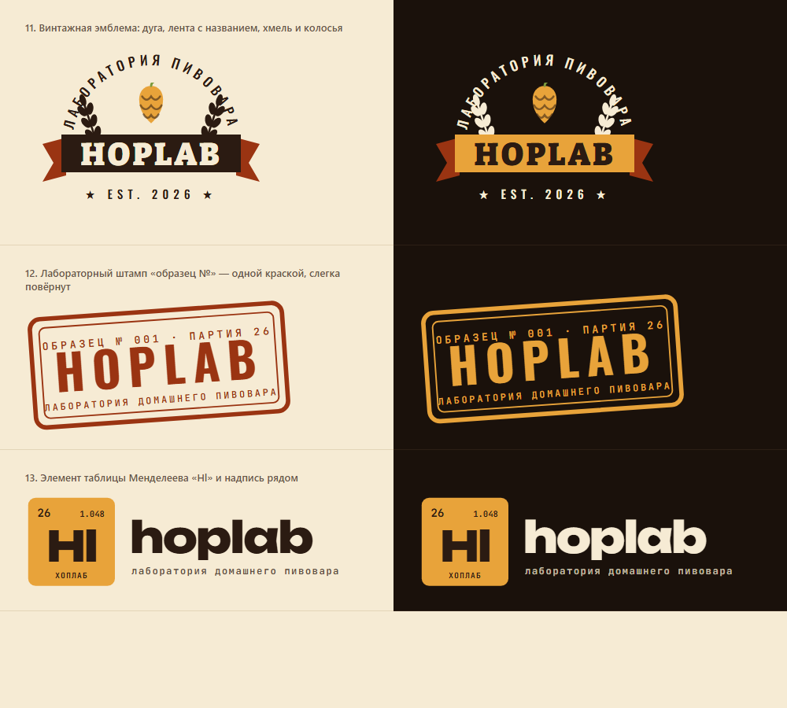
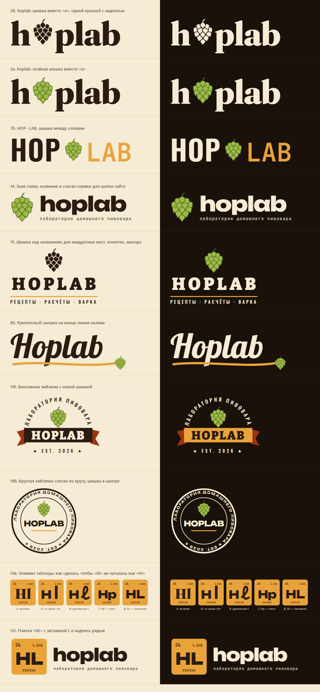
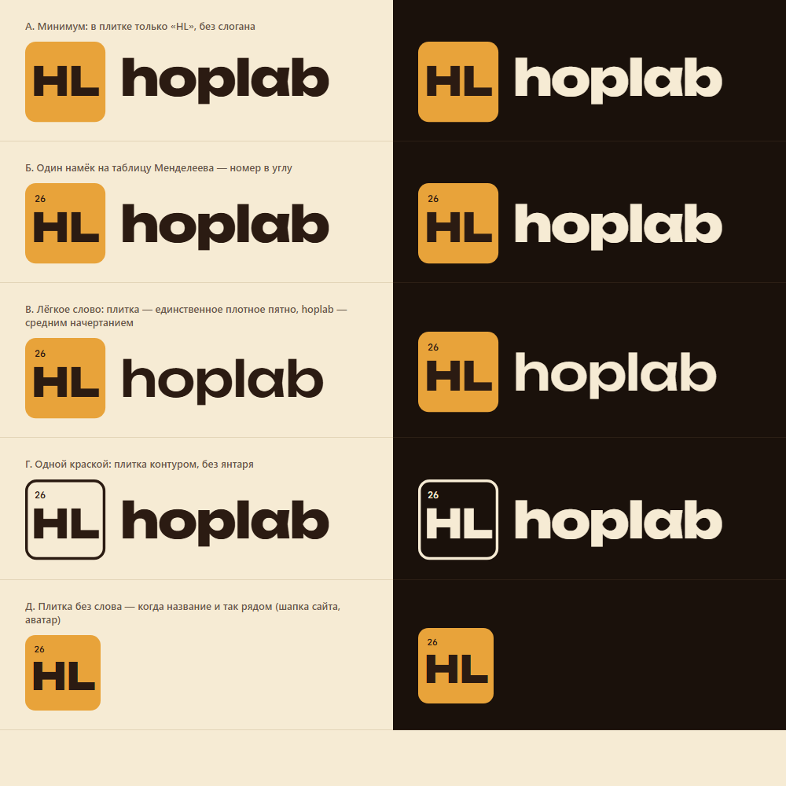
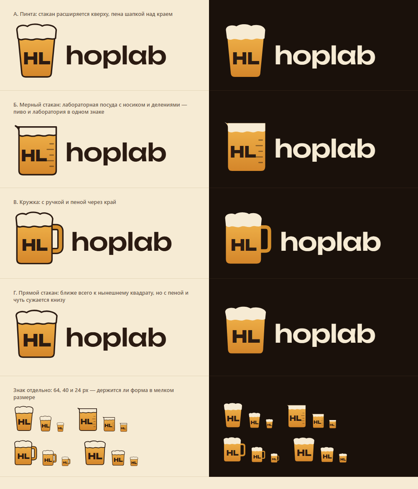
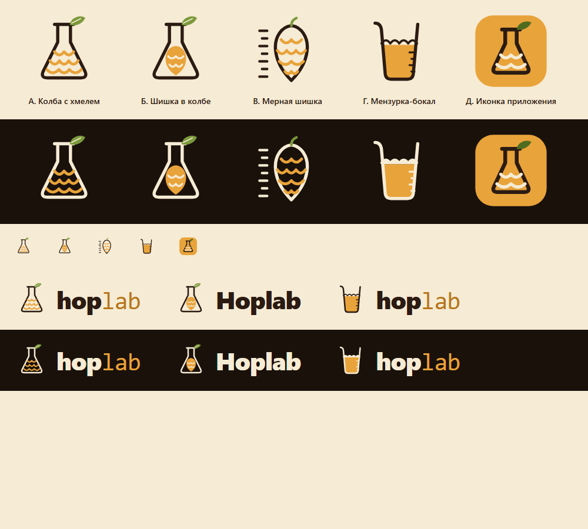

# Hoplab — название, слоганы, знак

Рабочее название — **Hoplab**, «лаборатория хмеля» (выбрано 27.10.2026, не окончательно; в интерфейсе пока «Пивоварня»). Почему оно и что отброшено — [roadmap.md, «Свой дизайн»](../../roadmap.md#идеи). Пишется **Hoplab** (в знаке — `hoplab` строчными), по-русски — «Хоплаб». Не «Hopslab»: по-русски читается как «хоп-слаб».

## Логотипы с названием

Знак встроен в само название — для шапки, этикетки, аватара. Четыре подборки, на светлом и тёмном фоне; исходники — HTML со встроенным SVG рядом (шрифты — Google Fonts). В подборках 1–3 шишка ещё старая (янтарная, с волнами — на хмель не похожа); подборка 4 — с перерисованной шишкой.

| | Вариант | Подборка |
|---|---|---|
| 1 | **HOPLAB с колбой вместо «A»** — уровень пива как перекладина, из горлышка — лист | [logos.html](./logos.html) |
| 2 | hoplab с шишкой вместо «o» | 〃 |
| 3 | hop + пробирка вместо «l» + ab моноширинным | 〃 |
| 4 | эмблема со слоганом по кругу (черновая — исправлена в 10) | 〃 |
| 5 | круглодонная колба вместо «b» | [logos-v2.html](./logos-v2.html) |
| 6 | **лист хмеля растёт из «h»** — минимально и живо | 〃 |
| 7 | HOP · LAB с шишкой-разделителем | 〃 |
| 8 | рукописный, как на крафтовой этикетке, с линией налива | 〃 |
| 9 | **HOP / LAB в две строки, «A» — колба** — для квадратных мест | 〃 |
| 10 | эмблема, исправленная | 〃 |
| 11 | **винтажная эмблема** — дуга «Лаборатория пивовара», лента с названием, хмель, колосья, EST. 2026 | [logos-v3.html](./logos-v3.html) |
| 12 | **лабораторный штамп** «Образец № 001 · партия 26» — одной краской, слегка повёрнут | 〃 |
| 13 | **элемент таблицы Менделеева «Hl»** и надпись `hoplab` рядом | 〃 |
| 2б, 2в | hoplab с шишкой вместо «o» — одной краской с надписью и зелёная | [logos-v4.html](./logos-v4.html) |
| 7б | HOP · LAB с новой шишкой | 〃 |
| 14 | **знак слева, название и слоган справа** — классическая связка для шапки сайта | 〃 |
| 15 | **шишка над названием HOPLAB** и «Рецепты · Расчёты · Варка» — для квадратных мест | 〃 |
| 8б, 11б, 10б | рукописный, винтажная и круглая эмблемы с новой шишкой | 〃 |
| 13в | плитка элемента пятью способами: в 13 пара «Hl» читалась как «HI», «l» с хвостиком — как «HJ». А — антиква, Б — «l» выше «H», В — рукописная «ℓ», Г — «Hp», Д — **«HL» с заглавной L** (как в варианте 9) | 〃 |
| 13г | **плитка «HL» и надпись `hoplab`** со слоганом | 〃 |

Подборка 3 сделана по подсказке скила ui-ux-pro-max (логотип для пивоварни: винтажная эмблема или печать, антиква с засечками, хмель и колос, без «корпоративной» стерильности).

## Плитка «HL» — разработка варианта 13г

Знак — элемент таблицы Менделеева «HL» (Hop + Lab), надпись `hoplab` шрифтом Unbounded.

- [logos-hl.html](./logos-hl.html) — полная плитка (номер 26, «1.048», «ХОПЛАБ»), плитка-бокал с пеной, «паспорт» с OG/IBU/EBC/ABV, цвета, вертикальная компоновка, иконка 96–16 px. Вывод: **перегружено** — в плитке четыре надписи, рядом жирное слово и слоган.
- [logos-hl-2.html](./logos-hl-2.html) — упрощение: в плитке только «HL» (или «HL» и номер в углу), без слогана; вариант с hoplab средним начертанием и вариант одной краской (плитка контуром). Слоган — не часть логотипа, ставится отдельно (под заголовком, на лендинге).

- [logos-hl-3.html](./logos-hl-3.html) — оранжевый квадрат обыгран бокалом: пиво с шапкой пены и «HL» внутри. А — пинта, Б — **мерный стакан** с носиком и делениями (пиво и лаборатория в одном знаке), В — кружка, Г — прямой стакан, ближе всего к квадрату. На светлом фоне — с контуром, иначе пена сливается с фоном.

## Шишка хмеля

Нарисована по классической иконке хмеля: острые чешуйки рядами 3-4-3-2-1, верхние ложатся на нижние остриём на стык, крайние отогнуты наружу и дают зубчатый край, силуэт — яйцо с острым низом. Два исполнения: [зелёная](./hop-cone.svg) и [одной краской](./hop-cone-mono.svg) (щели между чешуйками прозрачные — ложится на любой фон). Ранние попытки — [hop-cones.html](./hop-cones.html), [hop-cones-2.html](./hop-cones-2.html).

## Знаки отдельно (первые эскизы)

Эскизы — SVG в этой папке, сравнить на светлом и тёмном фоне и в 32 px — [preview.html](./preview.html).

## Слоганы

**Главные** — объясняют, что это:

- **Лаборатория домашнего пивовара** — основной кандидат
- Ваша пивная лаборатория
- Пивоварение с точностью до грамма

**Про точность и расчёты:**

- Рецепты, проверенные расчётом
- Точно рассчитано — вкусно сварено
- Больше пива, меньше догадок
- Варите смело — мы всё посчитали

**Про эксперимент:**

- Экспериментируй. Вари. Делись.
- Каждая варка — опыт
- Пиво — эксперимент, который получается

**Короткие — под логотип, в шапку, на этикетку:**

- Рецепты. Расчёты. Варка.
- Хмель. Солод. Точность.
- Наука, которую пьют

Рекомендация: «Лаборатория домашнего пивовара» — под знак и в описание сервиса; «Рецепты. Расчёты. Варка.» — коротко, в шапку и на этикетки; «Больше пива, меньше догадок» — для лендинга.

## Знак

| | Идея | Плюсы | Минусы |
|---|---|---|---|
| **А. Колба с хмелем** | колба Эрленмейера, внутри — сусло волнами, из горлышка растёт лист хмеля | сразу «лаборатория + живое», узнаётся в 32 px, хорошо на тёмном | волны — скорее кипение, чем хмель |
| **Б. Шишка в колбе** | в колбе — шишка хмеля | буквально «хмель в лаборатории» | мелко шишка похожа на лимон |
| **В. Мерная шишка** | шишка тонкой линией, рядом — шкала мерного цилиндра | своё, нигде не видел; «хмель, который измеряют» | в 32 px перегружен, нужна упрощённая версия |
| **Г. Мензурка-бокал** | лабораторный стакан с делениями, в нём пиво с пеной | двойное прочтение: и мензурка, и бокал | на тёмном фоне пена сливается с контуром — доработать |
| **Д. Иконка приложения** | знак А на янтарном квадрате | для вкладки, экрана «Домой» и уведомлений | — |

Надпись — `hop` плотным округлым шрифтом и `lab` моноширинным янтарным: живое плюс точное, как сам сервис. Цвета: тёмный солод `#2B1B12`, янтарь `#E8A33A`, зелень хмеля `#7C9A3C`, пена `#F6EBD4`.

Рекомендация: **А** — основной знак (с ним иконка **Д**), **Г** — запасной, если хочется прямого «пива» в знаке. Это эскизы, а не финал: после выбора направления — чистовая отрисовка, свой шрифт надписи и проверка на всех размерах.
